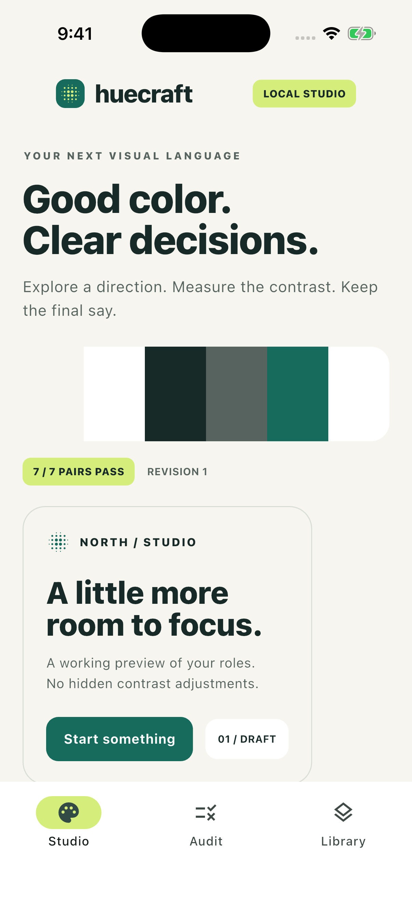
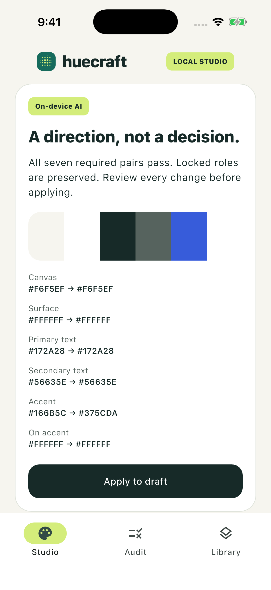
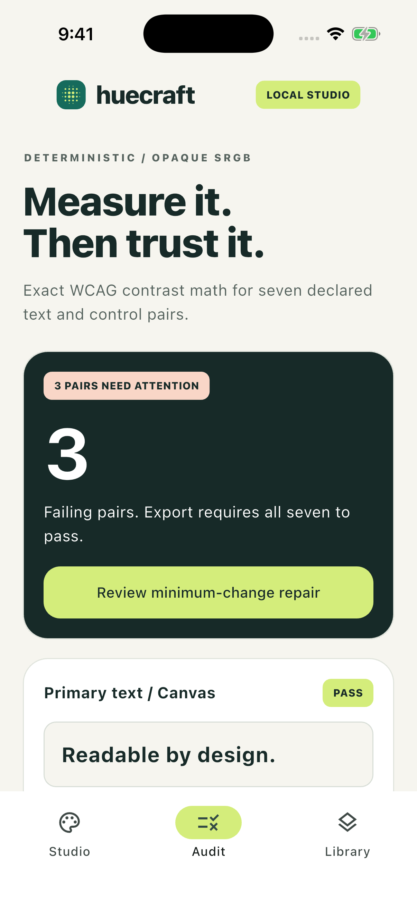
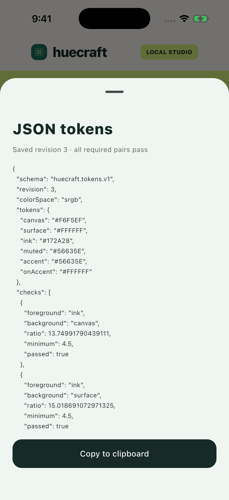
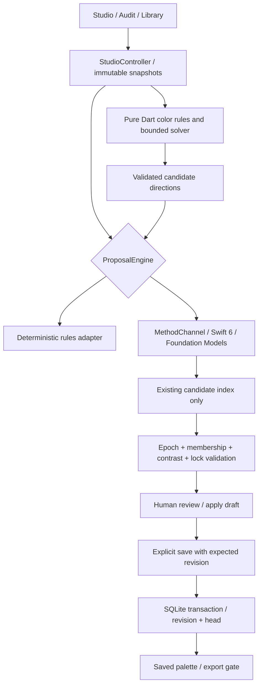

# Huecraft

A local Flutter palette studio: reviewed on-device directions, exact contrast checks and portable design tokens.

[](https://github.com/OwaisMunawar/huecraft/actions/workflows/ci.yml)


[](LICENSE)

<p>
  
  
  
  
</p>

Unedited iPhone 17 Pro **simulator** captures, iOS 26.5. Colors and briefs are synthetic. Apple Foundation Models really ranked the direction; the repair is a deterministic solver, explicitly labelled “no model.” [Full verification scope](docs/VERIFICATION.md).

## Why

A palette can look convincing and still fail where it is used. A model's opinion cannot establish text contrast, and fixing one color should not silently rewrite the roles a designer locked.

Huecraft treats a direction as a proposal. A pure Dart engine calculates seven declared contrast pairs and builds valid candidate assignments. The on-device model ranks those assignments against a brief; it never supplies colors or contrast figures. A person reviews the changes, applies a draft, then saves a revision. Export checks the saved palette again.

## Features

- **Six explicit roles.** Canvas, surface, primary text, secondary text, accent and on-accent. Assign from eight fixed opaque sRGB source colors and inspect the live sample interface.
- **Exact contrast decisions.** Relative luminance and contrast use the [WCAG 2.2 definition](https://www.w3.org/TR/WCAG22/#dfn-relative-luminance). Four normal-text pairs and button text require 4.5:1; two declared control-boundary pairs require 3:1. Display rounding never decides a pass.
- **Lock-preserving repair.** A bounded branch-and-bound search first minimizes changed roles, then squared RGB distance. It returns a proposal only after completing the search. Impossible locks and exhausted budgets are explicit failures; they never unlock a role or return an approximate repair.
- **A narrow native model boundary.** A Swift 6 bridge asks Foundation Models for one existing candidate index. Dart checks its type and range, validates contrast and locks again, and rejects results from an older draft epoch. No model output is applied automatically.
- **Explicit rules mode.** A labelled deterministic adapter uses the same proposal interface. A native request failure stays visible; selecting Rules is a user action. A build flag disables the native adapter for a fully deterministic demo.
- **Revision history that survives reopening.** SQLite saves the revision and current-head pointer together, checks the expected revision and uses triggers to reject normal updates/deletes of history rows. Restoring an older palette creates a draft; the next save adds another revision.
- **Guarded exports.** JSON tokens include the saved revision, exact ratios and declared thresholds. CSS variables carry the same six roles. Unsaved drafts and failed required pairs cannot be exported. Both formats have a clipboard action.
- **Responsive controls.** Shared design primitives, text-labelled pass/fail states, swatch semantics, wrapping layouts and scrollable sheets. Automated layouts exercise 375 logical pixels at 2× platform text scale.

## Architecture



Feature folders separate `domain`, `application`, `data` and `presentation`. Domain code imports only pure Dart libraries and other domain files; application code cannot import adapters or screens. Repository, model engine and clock are injected. A CLI boundary check runs in CI. [ADRs and rejected alternatives](docs/ARCHITECTURE.md).

## Tech stack

| Concern | Choice |
| --- | --- |
| Mobile | Flutter 3.44.2, Dart 3.12.2, Material 3 |
| Application state | Injected controller, immutable snapshots, broadcast stream |
| Local storage | sqflite 2.4.5, atomic revision/head updates, immutable-history triggers |
| Native directions | Apple Foundation Models, guided generation, Swift 6 complete concurrency checking |
| Validation | Pure Dart value objects, source-catalog membership and exact contrast predicates |
| Tests | Flutter Test, real SQLite FFI, mocked channel failures, macOS goldens, native integration_test |
| Delivery | Four CI jobs: quality, goldens, iOS simulator build, Android debug build |

Flutter 3.44.2 is pinned to the locally verified toolchain; this is not a claim that it is the newest Flutter release. SDK upgrades are reviewed together with native build and golden results.

## Quick start

Use Flutter 3.44.2 / Dart 3.12.2 and an iOS or Android development environment. No account, server or API key is required.

```sh
git clone https://github.com/OwaisMunawar/huecraft.git && cd huecraft
flutter pub get --enforce-lockfile
flutter run --dart-define=DEMO=true
```

The deterministic build selects **Rules · no model**. To use actual on-device ranking, run `flutter run` without that flag on an iOS 26 environment where Foundation Models reports availability. The UI shows availability; Android uses Rules.

In Studio, describe a direction, request a proposal, inspect the role changes, apply it and save a revision. To exercise the gate, assign `#D4ED7B` to Accent; Audit shows three failing pairs. Lock the other five roles, review a minimum-change repair, apply it and save. Library then enables JSON/CSS previews.

## Quality

```sh
dart format --output=none --set-exit-if-changed lib test integration_test tool
flutter analyze --fatal-infos
dart run tool/check_architecture.dart
flutter test --coverage --exclude-tags golden
dart run tool/coverage_gate.dart
flutter test --tags golden
```

- **33 automated tests passed**, including four screen interactions and real SQLite save/reopen, concurrent stale saves, rollback, history triggers and malformed-storage tests.
- **279/279 selected domain/application lines covered (100%)**; the gate requires at least 90% overall and in each selected file. This denominator excludes UI, bootstrap and platform adapters.
- Contrast invariants are checked on 500 deterministic random color pairs. The solver is checked against an exhaustive two-color oracle across all 64 starting assignments and 48 single-role catalog edits.
- **Three golden layouts passed**, with a 0.5% pixel-difference tolerance. A separate 2× text-scale regression catches narrow-layout overflows.
- Strict analysis, import boundaries, actionlint and strict SwiftLint passed locally. The native target uses Swift 6 complete concurrency checks and treats Swift warnings as errors.
- The actual simulator workflow ranked a cobalt direction using Foundation Models, required review, saved and reopened revision 2, repaired a deliberately failing accent while preserving five locks, saved revision 3 and previewed its checked JSON tokens.
- CI builds both native targets. Native inference runs locally rather than in CI because model availability depends on the OS environment.
- `.maestro/palette.yaml` is supplied for a `DEMO=true` build but **unrun**; Maestro is not installed in the verification environment.

[Verification record and screenshot provenance](docs/VERIFICATION.md) · [Contributing](CONTRIBUTING.md) · [Security scope](SECURITY.md)

## Known gaps

- This measures seven declared opaque sRGB pairs. It is **not a WCAG conformance certificate**: typography, focus, target size, state changes, color-only meaning, images, gradients and transparency need separate evaluation.
- The app has one fixed eight-color source catalog and one local workspace. There is no image extraction, arbitrary-color editor, palette import, cloud sync, account system or team collaboration.
- RGB distance is a deterministic tie breaker, not a perceptual color-difference metric. A minimum-change result can be visually less appealing; review remains necessary.
- Locks and the active draft are session state. Only saved palettes survive reopening. Closing before saving loses the draft.
- Local history has no retention/pagination, additional database encryption, biometric gate or backup/restore workflow. Triggers protect normal application writes, not against someone editing the database externally.
- The 45-second Dart model timeout bounds the UI wait; it does not cancel the OS generation task. Ranking quality is subjective and unbenchmarked.
- No physical-device, Android runtime, VoiceOver or production validation. Clipboard completion is not verified by the native workflow; JSON preview and its values are verified.

## Roadmap

- Editable catalogs and schema-validated palette import.
- Perceptual color-distance alternatives with reference-vector tests.
- Persisted draft/lock recovery, pagination and reviewed backup/restore.
- Physical-device accessibility and Android runtime verification.
- Additional declared pair profiles without implying whole-interface conformance.

Built by [Owais Munawwar](https://github.com/OwaisMunawar). I'm available for React Native, AI and iOS work on [Upwork](https://www.upwork.com/freelancers/owaism11).
